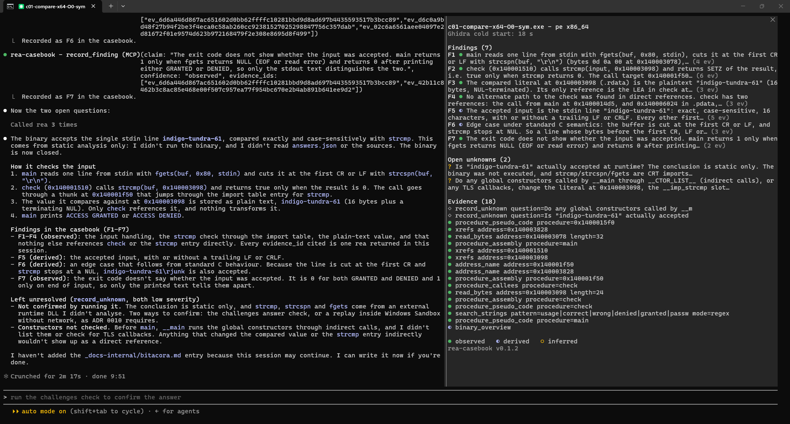
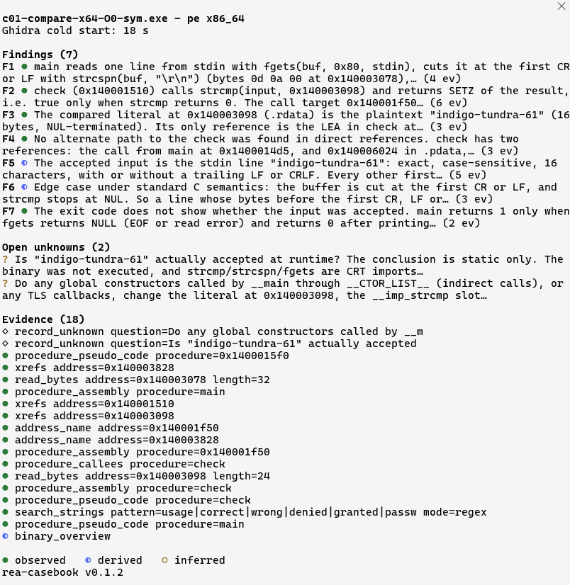
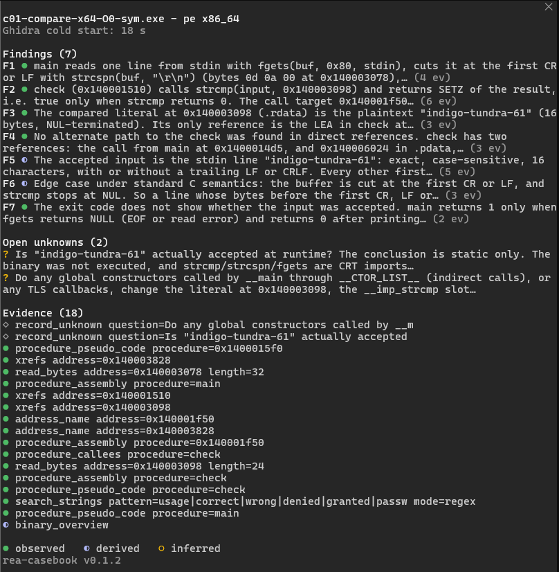
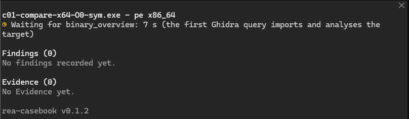

<h1 align="center">rea-casebook</h1>

<p align="center">
  A Claude Code mod that keeps a live casebook of what <a href="https://github.com/morluto/rea">rea</a> gives the agent while it reverse engineers a binary
</p>

<p align="center">
  
  
  
  
</p>

<p align="center"><a href="README.es.md">Leer en español</a></p>

<p align="center">
  
</p>

rea answers each analysis call with an Evidence record: an `evidence_id`, what was asked, how sure it is (observed, derived or inferred) and where it comes from. Those records live in rea's memory for as long as the MCP connection lasts, and in the transcript they scroll away among the model's text. rea-casebook collects them in a pane as they arrive, makes the wait for Ghidra visible, and gives the model a tool to record findings that **must cite Evidence rea actually delivered**.

It needs rea registered as an MCP server named `rea` (its tools appear as `mcp__rea__*`). It works with any binary rea opens; it was built on Windows with rea 6.4.0 and Ghidra 12.1.

## What the pane shows

| Section | What it holds |
|---|---|
| Target | The binary `open_binary` opened: file name, format and architecture |
| Wait | While a rea call runs, how long it has been waiting. The first Ghidra-backed query imports and analyses the target and can take minutes; the pane says so |
| Cold start | How long that first query took, kept for the session |
| Findings | What the model recorded with `record_finding`, each with a mark for its confidence and the number of Evidence records it cites, plus how many were refused |
| Open unknowns | The questions rea holds as residual unknowns (`record_unknown`, `update_unknown`, `list_unknowns`) until they are resolved |
| Evidence | The latest records, newest first: a mark for the confidence, the operation and its main parameters, and the authority when it is not the binary itself |

Confidence is drawn as a mark that differs in shape as well as color: ● observed, ◐ derived, ○ inferred (a legend sits at the bottom of the pane). Long findings and questions take two lines at most; the export keeps them whole. The words stay in the theme's text color, and color goes to the marks.

<p align="center">
  
  
</p>

<p align="center">
  
</p>

The pane opens by itself the first time the agent opens a binary, and `/casebook` opens it again. A footer names the mod's version, so you know which code is drawing.

## Findings that cite real Evidence

The mod adds one tool for the model, `record_finding`, with a claim, the `evidence_id` values that support it and a confidence (`observed`, `derived` or `inferred`). It records the finding only when every cited id came from a rea result in this session. An invented id, or one copied from another session, is refused, and the model reads which ids rea never delivered, so it can go back and get real Evidence. The refusals are counted in the pane.

The ids of the mutation Evidence that `record_unknown` and `update_unknown` return count as delivered too: "this is still unknown" is a finding that can cite them.

## How it works

1. Every call to a rea tool passes through a `tool.call` hook. The mod notes when it started, lets it run and reads the result the agent gets: an Evidence record, the target of `open_binary`, the unknowns of the session tools, or an error. The agent's result goes back untouched, and a failure inside the mod never refuses or repeats a rea call.
2. When a result is too large for the client and is saved to a file, the mod reads the Evidence from that file.
3. The mod never calls rea on its own. Everything it shows is what the agent already received.
4. The state lives in the session (`$.state`) and is drawn by the pane. A second `open_binary` keeps the Evidence of the first, so comparing two builds keeps both.

## The command

| Command | What it does |
|---|---|
| `/casebook` | Opens the pane |
| `/casebook export` | Writes the casebook as Markdown to `casebook-<target>.md` in the session's folder |
| `/casebook export <file>` | Writes it to that file instead |

The export has the target (name, format, architecture and SHA-256), the cold start, the findings with their Evidence, confidence and authority, the open unknowns and the Evidence list. It names the file, never its local path.

## Language

In `/config`, under rea-casebook, **Language** is `English` (the default) or `Español`. It sets the pane, the export and what Claude reads when a finding is refused. The tool's description stays in English, the language the model reads best.

## Permissions

The pane needs no rules: the mod reads the results of rea calls that your own rules already allowed, and calls nothing by itself.

`record_finding` is called by the model, so it goes through your permissions like any other tool: Claude Code may ask you each time, or the classifier may decide in auto mode. It only writes to the pane, so it is worth allowing in `.claude/settings.json` (the project's) or `~/.claude/settings.json`:

```json
{
  "permissions": {
    "allow": ["mcp__rea-casebook__record_finding"]
  }
}
```

`/casebook export` writes one file when you run it. The mod writes it through the engine, not through your rules.

## Install

Inside a Claude Code session:

```text
/plugin install rea-casebook --marketplace pablodiazjorge/rea-casebook
```

Or in a terminal:

```bash
claude plugin marketplace add pablodiazjorge/rea-casebook
```

```bash
claude plugin install rea-casebook@rea-casebook
```

## Development

Reading rea's results, the casebook's state, the export and the words are plain modules tested directly. The hooks are tested against a simulated engine whose rea answers with real rea 6.4.0 results, with local paths replaced (`tests/fixtures/rea.ts`).

```bash
claude plugin validate .claude-plugin/plugin.json
```

```bash
claude plugin test .
```

CI runs both on Ubuntu, macOS and Windows with Claude Code 2.1.296.

To try a change in a real session, start Claude Code with the folder as a plugin directory; it reloads the mod when its files change:

```bash
claude --plugin-dir .
```

## Status

Version 0.1 is the first working pane. Planned next: a journal per session outside your project, an export to an artifact and a short recording. The design is recorded in [rea-lab](https://github.com/pablodiazjorge/rea-lab) (ADRs 0015 to 0017).

## License

[MIT](LICENSE)
